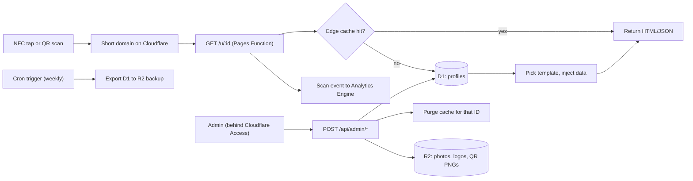

# 02. Architecture Plan

## 1. Goals and principles

1. **One deploy, many profiles.** No repo or folder per client. Ever.
2. **Data, not code, per client.** A profile is a database row. Templates are shared code.
3. **Templates change how data looks, never what data exists.** The data schema (`03`) is locked. Templates read it.
4. **The domain is the product's backbone.** Every printed card and sticker points to it. Never print a `pages.dev` or `vercel.app` URL.
5. **Keep the public page cheap and fast.** Static assets plus an edge-cached profile response. Most scans never touch the database.
6. **No build step for templates.** Plain HTML, CSS, JS (ES modules). TypeScript for backend code is optional but recommended (see D-008).
7. **Design for failure.** If the database is down, serve cached profiles. If a profile is missing, show a branded page. Never a raw error.

## 2. System diagram



## 3. Components

| Component | Cloudflare product | Responsibility |
| --- | --- | --- |
| Static templates, landing page, shared JS | Pages (or Workers static assets, see 3.1) | Serves `/t/*`, `/shared/*`, `/landing/*` |
| Profile route and API | Pages Functions | `/u/:id`, `/api/profile/:id`, claim, admin API |
| Database | D1 | Profiles, versions, orders, retailers, batches, edit requests |
| File storage | R2 | Profile photos, company logos, generated QR images, backups |
| Scan counting | Workers Analytics Engine (verify availability on your plan) | High-volume scan events without writing to profile rows |
| Cache | Cloudflare Cache API (or KV) | Cached profile responses, purged on edit |
| Admin protection | Cloudflare Access (Zero Trust) | Login wall for `/admin` and `/api/admin/*` |
| Abuse protection | WAF rate limiting, Turnstile on public forms | Anti-enumeration, spam control |
| Backups | Cron Trigger plus D1 Time Travel (verify retention) | Weekly export to R2, point-in-time restore |

### 3.1 Pages or Workers?

Cloudflare has been steering new projects toward Workers with static assets, while Pages remains supported (verify the current status when you start). The architecture is identical either way: static files plus functions plus D1. Choose whichever Cloudflare recommends on the day you start, and keep the code in `functions/` and `public/` so moving is easy.

## 4. Routes

| Route | Method | Purpose |
| --- | --- | --- |
| `/u/:id` | GET | The public profile (or redirect, claim page, suspended page) |
| `/api/profile/:id` | GET | Profile JSON, edge-cached (used by templates that fetch) |
| `/vcard/:id` | GET | Server-generated `.vcf` for Save contact (optional, see 6.3) |
| `/c/:id` | GET | Claim page for an unassigned card |
| `/api/claim` | POST | Customer submits profile info using a claim code (Turnstile protected) |
| `/api/edit-request` | POST | Customer submits an edit request |
| `/admin` | GET | Admin UI (behind Access) |
| `/api/admin/*` | various | Create/update profiles, batches, orders, suspend |
| `/healthz` | GET | Uptime check |
| `/t/:template/*` | GET | Static template assets |

Reserved path prefixes (never allowed as vanity slugs): `u`, `t`, `api`, `admin`, `c`, `vcard`, `healthz`, `landing`, `assets`, `shared`.

## 5. Request flows

### 5.1 Scan flow (the 99% case)

1. Phone opens `https://<domain>/u/k7x2mq`.
2. The Function checks the edge cache. On a hit, it returns immediately.
3. On a miss, it runs a single primary-key lookup in D1.
4. Based on `status`:
   - `active`: render the template (or redirect for `redirect` tier).
   - `unassigned`: show the claim/"coming soon" page.
   - `suspended` or `archived`: neutral "unavailable" page.
   - not found: branded 404.
5. It sends a scan event to Analytics Engine (non-blocking, `waitUntil`).
6. The response is cached with a short TTL (for example 5 minutes) plus `stale-while-revalidate`.

**Redirect tier rule: use `302`, never `301`.** Browsers cache `301` permanently, which would make link changes impossible for repeat visitors. Send `Cache-Control` with a short max-age.

### 5.2 Render strategy

Two options. Recommended: **option A** from the start.

| Option | How | Pros | Cons |
| --- | --- | --- | --- |
| A. Server-inject | `/u/:id` fetches the template HTML from static assets and inlines profile JSON plus Open Graph meta tags using `HTMLRewriter` | One request, fast first paint, good link previews in Messenger and Facebook | Slightly more Function code |
| B. Shell plus fetch | Static template loads, then `fetch('/api/profile/:id')` | Simplest, closest to your current script | Two round trips, no link-preview metadata |

Whichever you choose:

- Escape the inlined JSON (`<` as `\u003c`) to prevent script injection.
- Render user text with `textContent`, never `innerHTML`. Icons can be static SVG strings, but user values must never be concatenated into HTML.

### 5.3 Edit flow

1. Customer or retailer submits an edit request (form) or you edit in `/admin`.
2. Admin API validates against the schema (`03`), writes a new row to `profile_versions`, updates `profiles`, and bumps `version`.
3. The API purges the cache for `/u/:id` and `/api/profile/:id`.
4. Live within seconds.

### 5.4 New order flow (pre-generated stock)

1. `tools/id_generate.py` creates a batch of unassigned IDs in D1 (status `unassigned`).
2. The batch export drives QR generation, sticker printing, and NFC encoding (`06`).
3. At order time, assign an unassigned ID to the order. Fill the profile in admin (or send the customer a claim link).
4. Status moves `assigned` then `active` when the profile passes validation.

## 6. Security

### 6.1 Threats and controls

| Threat | Control |
| --- | --- |
| Enumerating IDs to scrape profiles | Random 7 to 8 character IDs (`03`), rate limits on `/u/*` and `/api/*`, bot management |
| XSS through user-entered fields | `textContent` rendering, escape injected JSON, strict CSP header |
| Malicious links (`javascript:`, `data:`) | URL scheme allowlist: `http`, `https`, `tel`, `mailto`, `viber`, `sms` only. Validated on save and again at render |
| Admin takeover | Cloudflare Access with 2FA. No public admin routes |
| Claim-code guessing | High-entropy claim codes, hashed in DB, attempt limits, Turnstile |
| Scam or abuse profiles | Instant `suspended` status, terms of service (`08`), report link on every page footer |
| Domain loss | Multi-year renewal, auto-renew, registrar 2FA, backup payment card (`06`) |
| Data loss | Weekly D1 export to R2, D1 Time Travel, test restores quarterly |
| NFC chip overwrite | Lock chips after writing, optional NTAG password protection (`06`) |

### 6.2 Headers

Send `Content-Security-Policy` (self plus inline-allowed only where needed), `X-Content-Type-Options: nosniff`, `Referrer-Policy`, and `Permissions-Policy`. Load no third-party scripts on profile pages.

### 6.3 vCard generation

Today the vCard is built in the browser. That works and can stay. A server route `/vcard/:id` is a later improvement: it makes Save contact work reliably in in-app browsers and lets you set proper vCard fields in one place.

### 6.4 Privacy note on scans

Count scans per profile and per day. Do not log visitor IPs, device fingerprints, or personal data with scan events. This keeps you out of most of the Data Privacy Act complications for visitors (`08`).

## 7. Capacity, cost, and limits

D1 limits and prices (Cloudflare pricing page, October 2026):

| | Workers Free | Workers Paid |
| --- | --- | --- |
| Rows read | 5 million/day | 25 billion/month included, then $0.001 per million |
| Rows written | 100,000/day | 50 million/month included, then $1.00 per million |

Free limits reset daily at 00:00 UTC. When the daily limit is hit, queries fail until the reset. **Do not run production on the free plan.**

Design rules that keep you under the limits:

1. **Index the ID.** `id` is the primary key. An unindexed lookup scans the whole table and multiplies rows read by table size.
2. **Do not index `scan_count`** (or avoid the column entirely). Writes to an indexed column cost extra rows written.
3. **Cache reads.** A viral or busy card should cost about one DB read per cache window, not one per tap.
4. **Never update the profile row per scan.** Use Analytics Engine, or batch increments into a daily table.
5. **Serve static assets from static hosting.** Only `/u/:id` and the API touch Functions.

Worked example: 200 sales per day for a year is about 73,000 profiles. At about 2 scans per profile per day that is about 146,000 scans per day. Reads are trivial. Per-scan writes would exceed the free write limit, which is another reason to use the paid plan and count scans outside the profile row.

Other limits to check on the Workers pricing page (verify): daily request caps on the free plan, CPU time per request, and Analytics Engine quotas.

## 8. Repository layout

```text
linkr/
├── public/
│   ├── t/
│   │   ├── glass-dark/        index.html, style.css, render.js, manifest.json
│   │   └── clean-white/       index.html, style.css, render.js, manifest.json
│   ├── shared/                parse.js, links.js, vcard.js, ui.js   (ES modules)
│   ├── landing/               public marketing page
│   └── assets/                favicons, fallbacks, icons
├── functions/
│   ├── u/[id].ts              profile route
│   ├── api/profile/[id].ts
│   ├── api/claim.ts
│   ├── api/edit-request.ts
│   ├── api/admin/             admin API
│   └── _lib/                  validate.ts, templates.ts, cache.ts, ids.ts
├── admin/                     admin UI (static, behind Access)
├── migrations/                0001_init.sql, 0002_...
├── tools/                     qr_generate.py, id_generate.py, export_chips.py
├── fixtures/                  minimal.txt, typical.txt, maximal.txt, long-text.txt, no-photo.txt, logo-only.txt
├── docs/                      this planning pack
└── wrangler.toml
```

Shared logic (parsing, link building, vCard, copy/share buttons) lives in `public/shared/` once. Each template holds only its own layout and styling. This replaces the "fix it in both scripts" problem.

## 9. Environments and deployment

- **Production** deploys from `main`. **Staging** deploys from a `staging` branch or pull request previews.
- Each environment has its own D1 database and R2 bucket. Never test against production data.
- D1 schema changes go through numbered migration files only. No manual edits to production tables.
- Template changes: open a pull request, review the preview deployment against every fixture (`03`), then merge.
- Secrets (Turnstile keys, etc.) live in Cloudflare environment secrets, never in the repo.

## 10. Template contract

Every template folder contains:

| File | Purpose |
| --- | --- |
| `index.html` | Semantic shell with render targets |
| `style.css` | Visual system using CSS variables |
| `render.js` | Imports from `/shared/`, renders the profile object |
| `manifest.json` | Declares capabilities (see `03`) |

Rules:

- Handle every optional field being absent: no empty boxes, no broken images, layout closes the gap.
- Handle 1 link and 15 links (capped quick actions, rest in list or "Show more").
- Support `logo_only` mode, or declare that it doesn't in the manifest.
- Hard text limits come from the schema. Templates still use `overflow-wrap: anywhere` and line clamping defensively.
- No user-controlled HTML.

## 11. Observability

- Uptime monitor on `/healthz` and on one known profile URL, with alerts to your phone.
- Log `rows_read` and `rows_written` from D1 query metadata for the first weeks to measure real usage.
- Track in Analytics Engine: scans per day, 404 rate, suspended-page hits, claim attempts.
- A daily summary (orders created, profiles activated, edit requests open) in admin.

## 12. Failure modes

| Failure | Behavior |
| --- | --- |
| D1 unavailable | Serve stale cached profile if present. Otherwise a branded "try again" page |
| Cache purge fails after edit | Short TTL means stale content is bounded to a few minutes. Retry purge, log it |
| Template file missing | Fall back to default template (`clean-white`) |
| Profile data invalid (should not happen) | Render safe minimal view from valid fields, log the error |
| Domain or Cloudflare account problem | Highest-severity incident. Runbook in `06` |
| Analytics Engine failure | Non-blocking. Profile still renders |

## 13. Migration approach

Detailed week-by-week in `07_ROADMAP.md`. Summary: build the new system, run it in parallel, move **new orders only** to it first, then migrate old Vercel clients one by one, keeping their old URLs alive as redirects to the new URLs.
