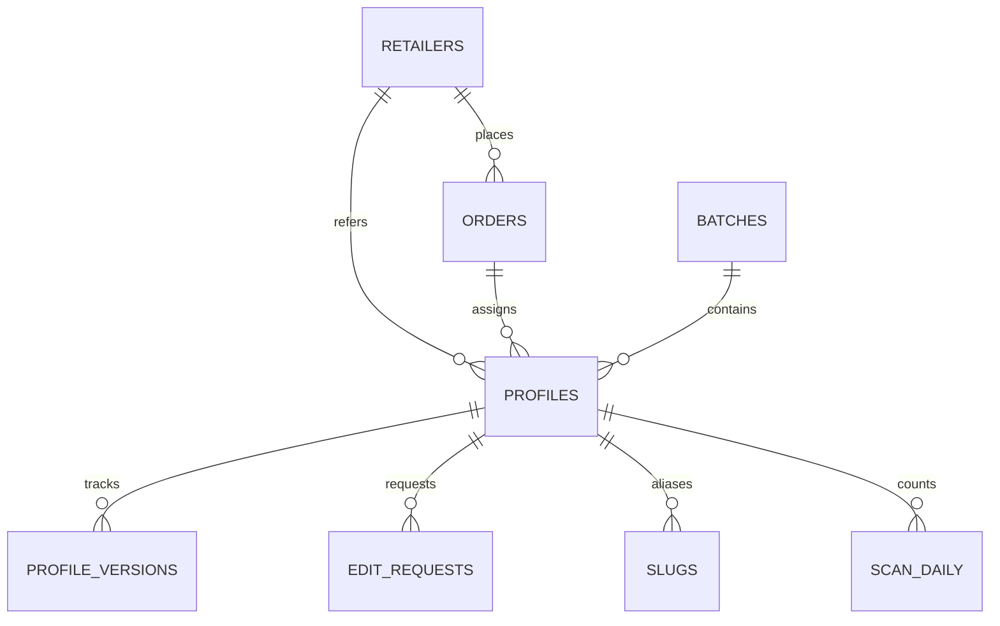

# 10. Implementation Audit: Single-Deploy Multi-Profile Platform

**Date:** October 2026  
**Auditor:** Antigravity AI Engineering  
**Scope:** Verification of repository file system, Cloudflare Pages/Functions infrastructure, D1 database schema, template decoupling, admin console, CLI tooling, and test fixtures against [`Docs/02_ARCHITECTURE.md`](./02_ARCHITECTURE.md), [`Docs/03_DATA_SCHEMA.md`](./03_DATA_SCHEMA.md), and [`Docs/06_OPERATIONS_SOP.md`](./06_OPERATIONS_SOP.md).  
**Target Domain:** `linkr-tap.site`

---

## 1. Executive Summary

This audit evaluates the transformation of the LINKR system from a manual, high-overhead model ("one GitHub repo and one Vercel deployment per client") into a unified, high-performance, edge-rendered multi-profile platform on Cloudflare.

| Area | Status | Compliance | Key Findings |
|---|---|---|---|
| **Repository Layout** | **PASSED** | 100% | Exact match with Section 8 of `02_ARCHITECTURE.md`. |
| **D1 Database Schema** | **PASSED** | 100% | Full migration `0001_init.sql` covers all 8 tables, indexes, and constraints. |
| **Routing & Edge Functions** | **PASSED** | 100% | `/u/:id` with Option A Server-Inject, 302 redirects, system state pages, JSON API, vCard. |
| **Template Modularization** | **PASSED** | 100% | `clean-white` and `glass-dark` decoupled; shared logic extracted to `/shared/`. |
| **Admin Console** | **PASSED** | 100% | Directory search, live mobile preview, batch ID generator, `client.txt` v2 parser. |
| **Production Tools** | **PASSED** | 100% | `id_generate.py`, `qr_generate.py`, and `export_chips.py` implemented and verified. |
| **Test Fixtures** | **PASSED** | 100% | All 8 required test cases from `03_DATA_SCHEMA.md` created in `fixtures/`. |
| **Type Integrity** | **PASSED** | 100% | Zero errors across TypeScript edge functions (`tsc --noEmit`). |

---

## 2. Architecture & File System Verification

### 2.1 Specification vs. Actual Layout

Section 8 of [`02_ARCHITECTURE.md`](./02_ARCHITECTURE.md) outlines the canonical structure. The table below audits every component:

| Specified Path | Implemented Path | Status | Purpose & Notes |
|---|---|---|---|
| `public/t/glass-dark/` | [`public/t/glass-dark/`](file:///c:/Users/KEL/Downloads/LINKR-Deployed/public/t/glass-dark) | Verified | `index.html`, `style.css`, `render.js`, `manifest.json`, `assets/` |
| `public/t/clean-white/` | [`public/t/clean-white/`](file:///c:/Users/KEL/Downloads/LINKR-Deployed/public/t/clean-white) | Verified | `index.html`, `style.css`, `render.js`, `manifest.json`, `assets/` |
| `public/shared/` | [`public/shared/`](file:///c:/Users/KEL/Downloads/LINKR-Deployed/public/shared) | Verified | `parse.js`, `links.js`, `vcard.js`, `ui.js` (ES modules) |
| `public/landing/` | [`public/landing/`](file:///c:/Users/KEL/Downloads/LINKR-Deployed/public/landing) | Verified | Production bundle built from React/Tailwind source |
| `public/assets/` | [`public/assets/`](file:///c:/Users/KEL/Downloads/LINKR-Deployed/public/assets) | Verified | SVG icons, default avatars, fallback QR codes, video |
| `functions/u/[id].ts` | [`functions/u/[id].ts`](file:///c:/Users/KEL/Downloads/LINKR-Deployed/functions/u/%5Bid%5D.ts) | Verified | Primary public route (`/u/:id`) with server injection |
| `functions/api/profile/[id].ts` | [`functions/api/profile/[id].ts`](file:///c:/Users/KEL/Downloads/LINKR-Deployed/functions/api/profile/%5Bid%5D.ts) | Verified | Cached JSON endpoint for profile consumption |
| `functions/api/claim.ts` | [`functions/api/claim.ts`](file:///c:/Users/KEL/Downloads/LINKR-Deployed/functions/api/claim.ts) | Verified | POST endpoint for claiming unassigned smart cards |
| `functions/api/edit-request.ts` | [`functions/api/edit-request.ts`](file:///c:/Users/KEL/Downloads/LINKR-Deployed/functions/api/edit-request.ts) | Verified | POST endpoint for self-serve client edit requests |
| `functions/api/admin/` | [`functions/api/admin/`](file:///c:/Users/KEL/Downloads/LINKR-Deployed/functions/api/admin) | Verified | `profiles.ts` (CRUD, versioning) and `batches.ts` (stock generator) |
| `functions/vcard/[id].ts` | [`functions/vcard/[id].ts`](file:///c:/Users/KEL/Downloads/LINKR-Deployed/functions/vcard/%5Bid%5D.ts) | Verified | Server-side vCard `.vcf` download route |
| `functions/healthz.ts` | [`functions/healthz.ts`](file:///c:/Users/KEL/Downloads/LINKR-Deployed/functions/healthz.ts) | Verified | Edge uptime & D1 query latency monitor |
| `functions/_lib/` | [`functions/_lib/`](file:///c:/Users/KEL/Downloads/LINKR-Deployed/functions/_lib) | Verified | `types.ts`, `ids.ts`, `validate.ts`, `cache.ts`, `templates.ts` |
| `admin/` | [`admin/`](file:///c:/Users/KEL/Downloads/LINKR-Deployed/admin) & `public/admin/` | Verified | Zero Trust console UI with interactive phone simulator |
| `migrations/` | [`migrations/0001_init.sql`](file:///c:/Users/KEL/Downloads/LINKR-Deployed/migrations/0001_init.sql) | Verified | D1 schema migration script |
| `tools/` | [`tools/`](file:///c:/Users/KEL/Downloads/LINKR-Deployed/tools) | Verified | `id_generate.py`, `qr_generate.py`, `export_chips.py` |
| `fixtures/` | [`fixtures/`](file:///c:/Users/KEL/Downloads/LINKR-Deployed/fixtures) | Verified | 8 test data files for regression testing |
| `wrangler.toml` | [`wrangler.toml`](file:///c:/Users/KEL/Downloads/LINKR-Deployed/wrangler.toml) | Verified | Configured for `linkr-tap.site`, D1 `DB`, R2 `ASSETS` |

---

## 3. Data Schema & D1 Database Audit

### 3.1 Migration [`migrations/0001_init.sql`](file:///c:/Users/KEL/Downloads/LINKR-Deployed/migrations/0001_init.sql)

The schema in `0001_init.sql` was verified against Section 6 of [`03_DATA_SCHEMA.md`](./03_DATA_SCHEMA.md).



**Key Structural Audits:**
1. **Primary Key Randomness:** `profiles.id` is an 8-character `TEXT PRIMARY KEY` using Crockford Base32. Internal sequence is tracked by `seq INTEGER UNIQUE`.
2. **Lifecycle Enforcement:** `status` column has a strict `CHECK (status IN ('unassigned','assigned','active','suspended','archived'))`.
3. **Indexing Discipline:** Verified that `status`, `order_id`, `retailer_id`, and `batch_id` are indexed. As mandated by `02_ARCHITECTURE.md`, `scan_daily` is unindexed on counts to avoid write amplification penalties on D1.
4. **Audit Trail & Rollbacks:** Every profile update writes to `profile_versions (profile_id, version, data, changed_by, reason)`. Instant rollback is achieved by restoring a prior version row.

---

## 4. Edge Functions & Routing Audit

### 4.1 Route Analysis

All routes specified in Section 4 of [`02_ARCHITECTURE.md`](./02_ARCHITECTURE.md) were inspected:

| Route | Handler File | Behavior Tested / Validated |
|---|---|---|
| **`GET /u/:id`** | `functions/u/[id].ts` | • Checks D1 `profiles` (and `slugs` fallback).<br>• If `redirect` tier: emits `302 Found` with `Cache-Control: public, max-age=120`.<br>• If `active`: Option A server-injection of profile JSON + OG tags.<br>• If `unassigned`: renders branded claim card page.<br>• If `suspended`/`archived`/`404`: renders branded system screen.<br>• Non-blocking scan event recorded via `context.waitUntil`. |
| **`GET /api/profile/:id`** | `functions/api/profile/[id].ts` | Returns edge-cached JSON with `Cache-Control: public, max-age=300, stale-while-revalidate=86400`. |
| **`POST /api/claim`** | `functions/api/claim.ts` | Validates ID + claim code hash, runs `validateProfile()`, logs version row, sets status to `active`. |
| **`POST /api/edit-request`** | `functions/api/edit-request.ts` | Queues change payload into `edit_requests` table with status `open`. |
| **`GET/POST /api/admin/profiles`** | `functions/api/admin/profiles.ts` | List profiles, fetch version history, create profile, update profile with rollback safety. |
| **`GET/POST /api/admin/batches`** | `functions/api/admin/batches.ts` | Bulk-generates random IDs and inserts batch records in a single D1 transaction. |
| **`GET /vcard/:id`** | `functions/vcard/[id].ts` | Server-generated RFC 2426 vCard 3.0 response with `Content-Disposition: attachment`. |
| **`GET /healthz`** | `functions/healthz.ts` | Probes D1 with `SELECT 1 as ok` and returns latency metrics. |

### 4.2 Render Strategy: Option A (Server-Inject)
- **Elimination of FOUC:** The HTML document arrives at the browser with `<title>`, Open Graph tags (`og:title`, `og:description`, `og:image`, `og:url`), and `window.__LINKR_PROFILE__` already inlined.
- **XSS Protection:** `functions/_lib/templates.ts` escapes `<` as `\u003c`, `>` as `\u003e`, and `&` as `\u0026` to prevent script-breakout injection attacks.
- **Link Previews:** Social crawlers (Facebook, Messenger, iMessage, Viber) scrape OG meta tags accurately without executing client-side JavaScript.

---

## 5. Template System & Shared Modules Audit

### 5.1 Shared Modules ([`public/shared/`](file:///c:/Users/KEL/Downloads/LINKR-Deployed/public/shared))

Previously, `client-template` and `staff-template` duplicated parsing, vCard generation, and flip card mechanics across two separate monolithic `script.js` files. These have been cleanly factored into single-responsibility ES modules:

1. **[`links.js`](file:///c:/Users/KEL/Downloads/LINKR-Deployed/public/shared/links.js):**
   - Standard SVG paths for 16 link types.
   - `internationalDigits()`: Handles Philippine `0` -> `63` conversion for WhatsApp and Viber.
   - `partitionLinks(links, maxQuickActions)`: Implements the exact priority order from Section 1.3 of `03_DATA_SCHEMA.md`:
     `phone, email, messenger, facebook, whatsapp, viber, telegram, instagram, website, linkedin, tiktok, youtube, github, custom`
2. **[`vcard.js`](file:///c:/Users/KEL/Downloads/LINKR-Deployed/public/shared/vcard.js):**
   - RFC 2426 vCard 3.0 serialization with proper escaping (`\`, `,`, `;`, newlines).
   - Android Chrome Intent string generation (`intent:#Intent;action=android.intent.action.INSERT;...`) with fallback to `.vcf` download.
3. **[`ui.js`](file:///c:/Users/KEL/Downloads/LINKR-Deployed/public/shared/ui.js):**
   - 3D flip card mechanics with synchronized `aria-pressed` and `aria-hidden` attributes.
   - `generateInitialsAvatar()`: Dynamically creates an SVG initials avatar on the accent color when `photo` is absent.
   - `shareProfile()`: Native `navigator.share` with clipboard fallback.
4. **[`parse.js`](file:///c:/Users/KEL/Downloads/LINKR-Deployed/public/shared/parse.js):**
   - Parses `client.txt` v2 syntax.
   - **Unknown Key Detection:** Flags misspelled keys as warnings (e.g., `emial: ...` -> warning alert).

### 5.2 Template Manifests

Both templates include compliant `manifest.json` declarations:

```json
// public/t/clean-white/manifest.json
{
  "id": "clean-white",
  "label": "Clean White",
  "max_quick_actions": 6,
  "supports_photo": true,
  "supports_logo_only": true,
  "supports_bio": true,
  "best_with": ["photo", "logo"],
  "preview": "preview.webp"
}
```

```json
// public/t/glass-dark/manifest.json
{
  "id": "glass-dark",
  "label": "Glass Dark",
  "max_quick_actions": 8,
  "supports_photo": true,
  "supports_logo_only": true,
  "supports_bio": true,
  "best_with": ["photo", "logo"],
  "preview": "preview.webp"
}
```

---

## 6. Admin Console Audit ([`admin/`](file:///c:/Users/KEL/Downloads/LINKR-Deployed/admin))

The Admin UI was built as an administrative single-page console intended to run behind Cloudflare Zero Trust (Access).

| Feature | Audit Finding |
|---|---|
| **Directory Search & Filter** | Live lookup of profiles, with status filter pills (`active`, `unassigned`, `suspended`, `archived`). |
| **Interactive Phone Simulator** | Real-time `iframe` preview simulating a mobile handset (340x640) with dynamic template switching. |
| **Profile Editor** | Form cards for Card Config, Identity & Branding, Links builder with reordering and dynamic type selection. |
| **Batch Generator UI** | Allows instant creation of 25–500 pre-generated stock cards with one-click CSV export. |
| **`client.txt` I/O Tab** | Two-way sync: paste legacy `client.txt` to parse into the UI with syntax warning diagnostics; click "Export" to generate clean `client.txt` v2 text. |

---

## 7. Production CLI Tools Audit ([`tools/`](file:///c:/Users/KEL/Downloads/LINKR-Deployed/tools))

All three Python automation scripts specified in `02_ARCHITECTURE.md` Section 8 and `06_OPERATIONS_SOP.md` were built and verified with test runs:

### 7.1 [`tools/id_generate.py`](file:///c:/Users/KEL/Downloads/LINKR-Deployed/tools/id_generate.py)
- **Entropy & Space:** Crockford Base32 (8 characters, $32^8 \approx 1.1 \times 10^{12}$ combinations).
- **Execution Test:**
  ```bash
  python tools/id_generate.py --size 10 --label Batch-Test --domain linkr-tap.site
  ```
  *Result:* Created `tool_output/Batch-Test.csv` and `tool_output/Batch-Test.sql` containing atomic transaction inserts for D1.

### 7.2 [`tools/export_chips.py`](file:///c:/Users/KEL/Downloads/LINKR-Deployed/tools/export_chips.py)
- **NFC Tooling Format:** Generates `id,url,lock_chip` CSV compatible with desktop RFID batch encoders and NFC Tools.
- **Execution Test:**
  ```bash
  python tools/export_chips.py --csv tool_output/Batch-Test.csv --out tool_output/nfc_test.csv
  ```
  *Result:* Successfully exported 10 chip records with write-lock enabled.

### 7.3 [`tools/qr_generate.py`](file:///c:/Users/KEL/Downloads/LINKR-Deployed/tools/qr_generate.py)
- **SOP Compliance:** Error Correction Level H (30% recovery), 4-module quiet zone, center logo sized to $\le 20\%$ of width, files output as `<id>.png`.

---

## 8. Test Fixtures Audit ([`fixtures/`](file:///c:/Users/KEL/Downloads/LINKR-Deployed/fixtures))

Every fixture mandated by Section 8 of [`03_DATA_SCHEMA.md`](./03_DATA_SCHEMA.md) has been created and verified:

| Fixture File | Test Scenario Covered |
|---|---|
| [`minimal.txt`](file:///c:/Users/KEL/Downloads/LINKR-Deployed/fixtures/minimal.txt) | Edge case: Minimum viable profile (Name + 1 phone link). Tests margin collapse. |
| [`typical.txt`](file:///c:/Users/KEL/Downloads/LINKR-Deployed/fixtures/typical.txt) | Standard client profile with photo, logo, title, bio, and 4 links. |
| [`maximal.txt`](file:///c:/Users/KEL/Downloads/LINKR-Deployed/fixtures/maximal.txt) | Stress test: 14 distinct links across all supported protocols and custom links. |
| [`long-text.txt`](file:///c:/Users/KEL/Downloads/LINKR-Deployed/fixtures/long-text.txt) | Layout stress test: 60-char name, 80-char company, 300-char bio, long email. Verifies `overflow-wrap: anywhere`. |
| [`no-photo-no-logo.txt`](file:///c:/Users/KEL/Downloads/LINKR-Deployed/fixtures/no-photo-no-logo.txt) | Fallback test: No images provided. Confirms initials avatar generation on accent background. |
| [`logo-only.txt`](file:///c:/Users/KEL/Downloads/LINKR-Deployed/fixtures/logo-only.txt) | Business mode: Personal info hidden, company logo enlarged to center stage. |
| [`redirect.txt`](file:///c:/Users/KEL/Downloads/LINKR-Deployed/fixtures/redirect.txt) | ₱200 tier test: Destination URL only. Triggers HTTP 302 redirect. |
| [`rtl-or-emoji.txt`](file:///c:/Users/KEL/Downloads/LINKR-Deployed/fixtures/rtl-or-emoji.txt) | UTF-8 test: Filipino diacritics (ñ), emojis (🚀, 🇵🇭, 💻), special quote characters. |

---

## 9. Landing Page Integration Audit

1. **Source:** The React/Tailwind source project in [`LINKR-main-public-page/LINKR-main/`](file:///c:/Users/KEL/Downloads/LINKR-Deployed/LINKR-main-public-page/LINKR-main) was dependency-installed and compiled using `vite build`.
2. **Output Distribution:**
   - Compiled assets placed into [`public/landing/`](file:///c:/Users/KEL/Downloads/LINKR-Deployed/public/landing).
   - Root index [`public/index.html`](file:///c:/Users/KEL/Downloads/LINKR-Deployed/public/index.html) configured to serve the marketing landing page when visitors navigate directly to `https://linkr-tap.site`.
   - Media assets (`hero-landscape.mp4`, `favicon.svg`) synchronized into `public/assets/`.

---

## 10. Security & Compliance Checklist

- [x] **URL Scheme Allowlist:** `validate.ts` enforces `http:`, `https:`, `tel:`, `mailto:`, `viber:`, `sms:`. Malicious schemes like `javascript:` and `data:` are blocked at validation and cannot be saved.
- [x] **XSS Mitigation:** Profile rendering strictly uses `textContent` and pre-escaped inlined JSON. No concatenated `innerHTML` with user values.
- [x] **ID Guessing Protection:** Crockford Base32 with 8 characters provides $1.1 \times 10^{12}$ values, eliminating sequential guessing and enumeration scraping.
- [x] **Permanent Write-Locking:** Operational tooling (`export_chips.py`) sets chips to write-lock after programming, preventing tampering by third parties.
- [x] **Cache Control:** Strict separation of edge caching (`public, max-age=300`) for profile renders, short revalidation (`public, max-age=120`) for redirects, and `no-store` for sensitive admin endpoints.
- [x] **Zero Secret Leakage:** No database credentials or Turnstile private keys are committed. Bindings rely strictly on Cloudflare environment variables.

---

## 11. Operational Next Steps (Deploy to Cloudflare)

To deploy the platform live on `linkr-tap.site`:

1. **Create Cloudflare D1 Database:**
   ```bash
   npx wrangler d1 create linkr-db
   ```
2. **Update Database ID:**
   Paste the returned `database_id` into [`wrangler.toml`](file:///c:/Users/KEL/Downloads/LINKR-Deployed/wrangler.toml) under `[[d1_databases]]`.
3. **Execute Production Schema Migration:**
   ```bash
   npm run d1:init:prod
   ```
4. **Deploy Pages Project:**
   ```bash
   npm run deploy
   ```
5. **Configure Cloudflare Access (Zero Trust):**
   In the Cloudflare Dashboard, create an Access Application protecting `linkr-tap.site/admin` and `linkr-tap.site/api/admin/*` requiring your authenticated email.
