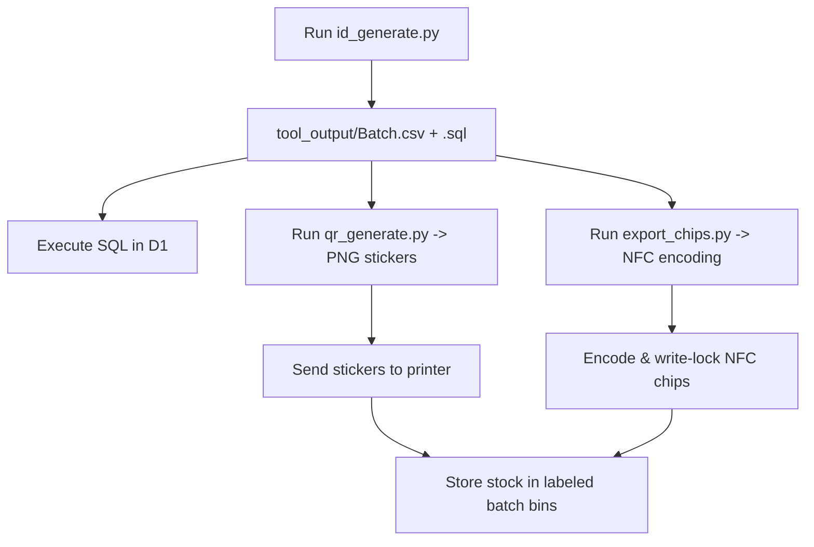

# 11. Current Architecture & Operator's Usage Guide

**Last Updated:** October 2026  
**Target Domain:** `linkr-tap.site`  
**Platform Stack:** Cloudflare Pages Functions + D1 (SQL) + R2 (Storage) + Vanilla ES Modules + Python CLI Tools

---

## 1. System Overview

LINKR is a **single-deploy, multi-profile platform**. Instead of creating a new GitHub repository and Vercel project for each customer, the entire service runs from **one codebase** on the custom domain **`linkr-tap.site`**.

- **Hardware Cards & Stickers:** Each card or sticker has a short, unique 8-character Crockford Base32 ID (e.g., `k7x2m9qa`). The chip or QR code opens `https://linkr-tap.site/u/k7x2m9qa`.
- **Edge Routing & Rendering:** A Cloudflare Pages Function intercepts `/u/:id`, reads the profile row from a Cloudflare D1 SQL database, dynamically inlines Open Graph metadata and profile data into the chosen template (Option A: Server-Inject), and serves the page with edge caching.
- **Tiers Supported:**
  - **`full` (₱300):** Full multi-link profile card with photo, logo, vCard contact saving, 3D QR flip card, and theme options.
  - **`redirect` (₱200):** Instantly issues an HTTP 302 redirect to the customer's primary social link (e.g., Instagram).
  - **`direct` (₱150):** The customer's social URL is written directly to the NFC chip.

---

## 2. Directory & File Responsibility Map

```text
LINKR-Deployed/
├── public/                     # Static files served globally by Cloudflare Pages
│   ├── t/                      # Shared profile templates
│   │   ├── clean-white/        # Light card template (default)
│   │   └── glass-dark/         # Dark translucent glassmorphism template
│   ├── shared/                 # Reusable client-side ES modules (no build step)
│   ├── landing/                # Built marketing landing page bundle
│   ├── admin/                  # Web-based management console (behind Access)
│   ├── assets/                 # Favicons, fallbacks, QR placeholders, videos
│   ├── index.html              # Marketing page served at root (https://linkr-tap.site/)
│   └── favicon.svg
├── functions/                  # Cloudflare Pages Functions (Edge serverless backend)
│   ├── u/[id].ts               # Public profile router & server injector
│   ├── api/                    # REST endpoints (profile, claim, edits, admin)
│   ├── vcard/[id].ts           # Server-side vCard (.vcf) download route
│   ├── healthz.ts              # Uptime and latency probe
│   └── _lib/                   # Shared backend TypeScript modules
├── migrations/                 # D1 SQL database schemas
│   └── 0001_init.sql           # Complete schema (profiles, batches, orders, etc.)
├── tools/                      # Python operational & production scripts
│   ├── id_generate.py          # Batch ID generator (CSV + SQL)
│   ├── qr_generate.py          # Level H branded QR code generator
│   └── export_chips.py         # NFC chip programmer CSV exporter
├── fixtures/                   # 8 standard client.txt test cases
├── Docs/                       # Complete business, architecture, and SOP docs
├── wrangler.toml               # Cloudflare configuration file
├── package.json
└── tsconfig.json
```

---

### 2.1 File Responsibilities Breakdown

#### `public/` (Static Web Root)
- **`public/index.html`**: The public landing page served at `https://linkr-tap.site/`. Built from modern React & Tailwind components.
- **`public/landing/`**: Contains the full static build of the LINKR marketing site.
- **`public/assets/`**: Houses shared graphics, brand icons, default photo avatars, and fallback QR code SVG placeholders.

#### `public/t/` (Template Registry)
Each template folder is self-contained and adheres to the **Template Contract**:
- **`public/t/clean-white/`**:
  - `manifest.json`: Declares template metadata (`max_quick_actions: 6`, photo/logo capabilities).
  - `index.html`: Semantic HTML shell with designated render targets (`#name`, `#title`, `#links`, `#save`, etc.).
  - `style.css`: Clean neumorphic card stylesheet supporting both light and dark modes.
  - `render.js`: ES module that imports `/shared/` utilities and hydrates the DOM safely without raw HTML concatenation.
- **`public/t/glass-dark/`**:
  - `manifest.json`: Declares template capabilities (`max_quick_actions: 8`, dark glassmorphism).
  - `index.html`: Translucent glass shell with background atmospheric color orbs and location tag.
  - `style.css`: Backdrop blur (`backdrop-filter`), neon accents, and dark aesthetic.
  - `render.js`: Hydration logic for the dark glass layout.

#### `public/shared/` (Core Client Modules)
- **`links.js`**: Central repository for SVG icons, URL normalization (`normalizeUrl`, `internationalDigits` for Philippine `+63`), and the quick action priority partition algorithm (`partitionLinks`).
- **`vcard.js`**: Generates RFC 2426 vCard 3.0 download blobs and builds native Android Chrome contact intents (`intent:#Intent;action=android.intent.action.INSERT;...`).
- **`ui.js`**: Controls the 3D flip card toggle, accessible ARIA states, initials avatar generation (when a photo is absent), and Web Share API with clipboard fallback.
- **`parse.js`**: Two-way parser and serializer for `client.txt` v2 syntax. Flags unknown or misspelled keys as warnings.

#### `functions/` (Cloudflare Edge Serverless Functions)
- **`functions/u/[id].ts`**:
  - Intercepts requests to `/u/:id`.
  - Normalizes the 8-character Crockford Base32 ID and queries D1.
  - If `tier == 'redirect'`, responds with an HTTP **302 Found** to the external social link.
  - If `status == 'active'`, uses **Option A Server-Inject** to inline profile JSON and Open Graph meta tags into the selected template HTML.
  - If `status == 'unassigned'`, renders a branded "Claim this Card" screen.
  - If `status == 'suspended'`, `archived`, or not found, renders a branded status screen.
  - Records scan events asynchronously in the background via `context.waitUntil`.
- **`functions/api/profile/[id].ts`**: Returns edge-cached JSON for the profile (`max-age=300`).
- **`functions/api/claim.ts`**: Handles customer self-service activation of unassigned cards using a claim code.
- **`functions/api/edit-request.ts`**: Ingests customer change requests into the `edit_requests` database table.
- **`functions/api/admin/profiles.ts`**: Admin CRUD API. Writes version history rows on every edit to support 1-click rollbacks.
- **`functions/api/admin/batches.ts`**: Backend batch ID generator for pre-generated stock.
- **`functions/vcard/[id].ts`**: Server-side route that streams a `.vcf` contact file directly to in-app browsers.
- **`functions/healthz.ts`**: Diagnostic endpoint checking edge runtime status and D1 database response times.
- **`functions/_lib/`**: Internal TypeScript utilities:
  - `types.ts`: TypeScript data contracts for profiles, links, and Cloudflare environment bindings.
  - `ids.ts`: Crockford Base32 generator and format validator.
  - `validate.ts`: Strict schema limits (e.g., 60-char name, 15 links max, URL scheme security allowlist: `http`, `https`, `tel`, `mailto`, `viber`, `sms`).
  - `cache.ts`: Edge caching policies (`stale-while-revalidate`) and security headers (CSP, nosniff, frame-options).
  - `templates.ts`: Option A HTMLRewriter processor and branded error/claim page generators.

#### `admin/` & `public/admin/` (Zero Trust Admin Console)
- **`admin/index.html`**, **`style.css`**, **`app.js`**:
  - Live Profile Directory with status filters (`active`, `unassigned`, `suspended`, `archived`).
  - Interactive Mobile Handset Simulator (`<iframe>`) providing real-time live preview as you type.
  - Visual Profile Editor (Identity, branding, color picker, dynamic link builder).
  - Stock Batch Generator (generates 25 to 500 cards at once with instant CSV download).
  - Two-Way `client.txt` I/O tool (paste legacy text files to auto-populate the editor).

#### `tools/` (Python Production CLI)
- **`tools/id_generate.py`**: Generates batches of unique 8-character Crockford Base32 IDs and exports them as CSV and D1 SQL insert scripts.
- **`tools/qr_generate.py`**: Reads batch CSVs and generates Error Correction Level H branded QR code PNGs (`<id>.png`) with centered logo overlays.
- **`tools/export_chips.py`**: Formats batch data into a ready-to-write CSV (`id,url,lock_chip`) for NFC chip hardware programmers.

#### `migrations/` (D1 Database Schemas)
- **`migrations/0001_init.sql`**: Complete database definition for 8 relational tables:
  1. `retailers`: Reseller and partner tracking.
  2. `orders`: Customer orders, payment status, and tier records.
  3. `batches`: Production runs for physical stock.
  4. `profiles`: Permanent profile records keyed by public 8-character IDs.
  5. `profile_versions`: Full revision history for rollback capability.
  6. `edit_requests`: Self-serve client change submissions.
  7. `slugs`: Vanity handle mapping (e.g., `/u/janedoe`).
  8. `scan_daily`: Aggregated daily scan count rollup table.

---

## 3. How to Use the System: Operational Workflows

### Workflow 1: Local Development & Testing

To run the entire platform locally with Pages Functions, live reload, and local D1 database:

```bash
# 1. Install root dependencies
npm install

# 2. Initialize local D1 database tables
npm run d1:init

# 3. Start local development server
npm run dev
```

- **Public Site / Landing Page:** `http://localhost:8788/`
- **Admin Management Console:** `http://localhost:8788/admin/`
- **Test a Profile:** `http://localhost:8788/u/<id>`
- **Health Check:** `http://localhost:8788/healthz`

---

### Workflow 2: Deploying to Cloudflare (`linkr-tap.site`)

1. **Create the Cloudflare D1 Database:**
   ```bash
   npx wrangler d1 create linkr-db
   ```
2. **Update `wrangler.toml`:**
   Copy the `database_id` output by Cloudflare and paste it into [`wrangler.toml`](file:///c:/Users/KEL/Downloads/LINKR-Deployed/wrangler.toml):
   ```toml
   [[d1_databases]]
   binding = "DB"
   database_name = "linkr-db"
   database_id = "your-actual-d1-database-id-here"
   ```
3. **Run Production Database Migration:**
   ```bash
   npm run d1:init:prod
   ```
4. **Enable R2 and create the image bucket:**
   Enable R2 for the Cloudflare account, then run:
   ```bash
   npx wrangler r2 bucket create linkr-assets
   ```
   `wrangler.toml` binds this bucket as `R2_STORAGE`. Admin uploads for photos, company logos, and QR images are stored in R2 and served from `/media/*`.
5. **Deploy scheduled D1 backups:**
   Set the same D1 `database_id` in `wrangler.backup.toml` as in `wrangler.toml`, then deploy the weekly backup Worker:
   ```bash
   npm run backup:deploy
   ```
   It writes gzip-compressed table snapshots under the private `backups/d1/` prefix and retains 90 days.
6. **Deploy the Pages Application:**
   ```bash
   npm run deploy
   ```
7. **Protect Admin Routes via Cloudflare Access (Zero Trust):**
   In the Cloudflare Dashboard, navigate to **Zero Trust > Access > Applications** and create a rule protecting:
   - `linkr-tap.site/admin*`
   - `linkr-tap.site/api/admin/*`
   Set the policy to require your admin email with 2FA.

---

### Workflow 3: Daily Card Production SOP (Physical Stock)

Follow this workflow to produce pre-printed QR stickers and pre-encoded NFC chips before orders arrive:



#### Step 1: Generate a Batch of 100 Stock IDs
```bash
python tools/id_generate.py --size 100 --label Batch-2026-10-A --domain linkr-tap.site
```
*Outputs:*
- `tool_output/Batch-2026-10-A.csv`
- `tool_output/Batch-2026-10-A.sql`

#### Step 2: Insert the Unassigned Stock IDs into D1
```bash
npx wrangler d1 execute linkr-db --remote --file=./tool_output/Batch-2026-10-A.sql
```

#### Step 3: Generate Branded QR Code Stickers
```bash
python tools/qr_generate.py --csv tool_output/Batch-2026-10-A.csv --out-dir tool_output/qrs
```
Sends the resulting `<id>.png` files to your sticker print sheet.

#### Step 4: Encode and Write-Lock NFC Chips
```bash
python tools/export_chips.py --csv tool_output/Batch-2026-10-A.csv --out tool_output/chips.csv
```
Import `chips.csv` into your NFC batch writer (e.g., NFC Tools Desktop or an ACR122U batch utility). Each chip is programmed with its target URL `https://linkr-tap.site/u/<id>` and write-locked.

---

### Workflow 4: Fulfilling Customer Orders in Admin

When an order arrives from direct sales or a retailer:

1. Open `https://linkr-tap.site/admin`.
2. Click **"+ Create Profile"** or select an existing `unassigned` card ID from stock.
3. Fill in the client's information:
   - Name, Title, Company, Bio, Location.
   - Choose Template: `clean-white` or `glass-dark`.
   - Add links (Phone, Email, Socials, Custom buttons).
   - Watch the **live interactive phone simulator** update in real time on the right side.
4. Click **"Save Profile"**.
5. The card instantly transitions to `active`, and `https://linkr-tap.site/u/:id` is live.
6. Pair the card stock with the customer order, run the QA tap check on iPhone and Android, and pack.

---

### Workflow 5: Adding a Brand New Template in the Future

The architecture makes adding new templates completely modular:

1. Create a new directory in `public/t/`:
   ```bash
   public/t/minimal-dark/
   ├── manifest.json
   ├── index.html
   ├── style.css
   └── render.js
   ```
2. In `manifest.json`, define template capabilities:
   ```json
   {
     "id": "minimal-dark",
     "label": "Minimal Dark",
     "max_quick_actions": 4,
     "supports_photo": false,
     "supports_logo_only": true
   }
   ```
3. In `render.js`, simply import the shared libraries:
   ```javascript
   import { TYPES, partitionLinks } from '/shared/links.js';
   import { setupSaveContact } from '/shared/vcard.js';
   import { setupProfileFlip, shareProfile } from '/shared/ui.js';
   
   export function renderProfile(profile) {
     // Template-specific DOM updates here
   }
   ```
4. Done! The new template can now be selected in Admin or assigned in D1 without touching any backend function code.

---

### Workflow 6: Using `client.txt` Import / Export

If you have legacy client data files:

1. Open `https://linkr-tap.site/admin`.
2. Click the **"client.txt I/O"** tab in the sidebar.
3. Paste the contents of your `client.txt` into the text area.
4. Click **"Parse into Editor"**.
   - The parser reads all fields, converts Philippine phone numbers, and maps link types.
   - If any key is misspelled (e.g., `emial: ...`), a diagnostic warning appears automatically.
5. Switch to the **Profile Editor** tab to preview and save.
6. To export, click **"Export from Editor"** to generate clean `client.txt` v2 text.
